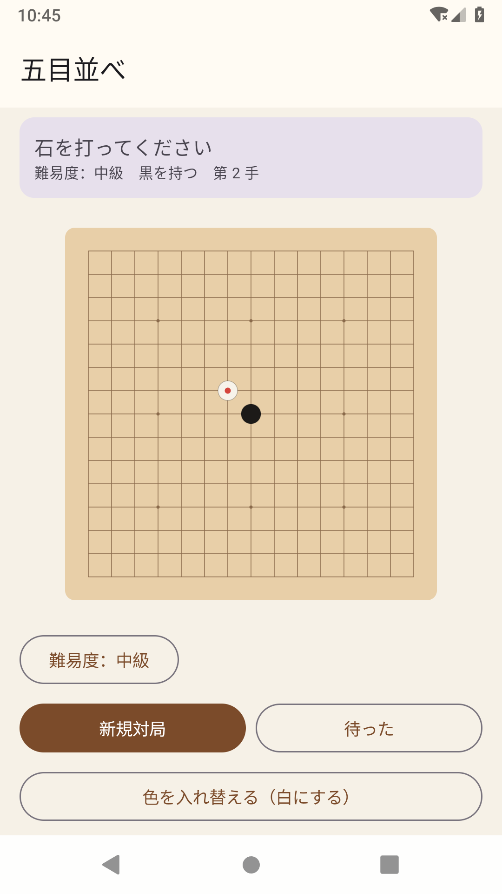

# 五目並べ（Gomoku）

> コメント・ドキュメント・画面文字列は日本語に統一しています。用語の基準は [`docs/glossary-ja.md`](docs/glossary-ja.md) を参照してください。

Android ネイティブの五目並べアプリ。Kotlin + Jetpack Compose の画面、自作の α-β 探索 AI（四追いによる必勝読みを含む）、権限不要・ネットワーク通信なし・アンインストール後にデータが残らない設計になっています。



## 機能

- **15×15 の標準盤**、自由五目ルール（五連で勝ち、禁手なし）、黒が常に先手
- **4 段階の AI 難易度**：初級 / 中級 / 上級 / 最上級。探索深度 2～8 層、1 手あたりの思考時間上限 0.3～4 秒。上級以上では四追い（VCF）を有効化
- **対局操作**：新規対局、待った、色を入れ替える（黒 / 白。色を入れ替えても「黒が先手」は変わらず、入れ替え後は AI が黒で初手を打つ）
- **着手の補助**：直近の一手に赤い点、決め手の五連を強調表示
- **自動保存**：着手のたびに手順を保存し、終了やプロセス回収後の再起動時に自動で復元
- **ライト／ダークテーマ**：システム設定に追従
- **アクセシビリティ**：石の数と勝敗をセマンティクス情報としてスクリーンリーダーに公開

## 技術構成

UI 層は描画と入力のみを担い、棋力はすべて `engine` パッケージの純 Kotlin 実装が担当する。サードパーティ製 AI ライブラリやモデルファイルには依存しない。

| モジュール | 内容 |
| --- | --- |
| `engine/Board.kt` | 盤面の状態と Zobrist ハッシュ |
| `engine/LineTable.kt` | 4 方向の行・列・斜めのインデックス表。探索中の重複スキャンを避ける |
| `engine/Evaluator.kt` | 差分更新による局面評価（活三・四・達四などの石の形を点数化） |
| `engine/Searcher.kt` | negamax + α-β 枝刈り + 置換表 + 反復深化 + 時間制御（キャンセルコールバック付き）、および四追い（VCF） |
| `game/GameState.kt` | 着手の正当性、勝敗判定、待った、局面復元 |
| `game/AiEngine.kt` | 難易度パラメータ（深度 / 時間 / ランダム性 / 四追いの有無）のまとめ |
| `game/GameViewModel.kt` | UI 状態、コルーチンによる AI 思考、セーブデータの読み書き |
| `data/GameStore.kt` | アプリ専用 SharedPreferences のみを使う対局データの保存 |
| `ui/` | Compose の盤面（Canvas 描画＋タッチ座標変換）、メイン画面、テーマ |

探索は `Dispatchers.Default` 上で実行し、UI スレッドでは棋力計算を行わない。1 手ごとに独立した探索器インスタンスを生成し、キャンセル時や対局のやり直し時には古い探索が直近のチェックポイントで終了する。

四追い（VCF）が成立するのは「相手に 1 手で五連を作る脅威がない」場合に限られる。連続した四で攻めるには相手が毎手受けざるを得ないことが前提であり、相手に別の五連成立点がある場合は受けを優先する。

## ビルド

必要環境：JDK 17、Android SDK Platform 34。

```bash
# プロジェクト直下に local.properties を作成し、ローカルの SDK を指定する
echo "sdk.dir=/path/to/android-sdk" > local.properties

./gradlew assembleDebug      # 生成物：app/build/outputs/apk/debug/app-debug.apk
./gradlew testDebugUnitTest  # 52 件の単体テスト：盤面ルール、評価、探索、対局フロー、セーブデータ、アクセシビリティ
```

最小対応 Android 7.0（API 24）、ターゲット API 34。

## プライバシーとアンインストール

- `AndroidManifest.xml` には権限を一切宣言していない（ネットワーク通信、外部ストレージの読み書き、端末情報の取得は行わない）。ビルド時に AndroidX が独自の signature レベル権限 `DYNAMIC_RECEIVER_NOT_EXPORTED_PERMISSION` を自動マージするのみで、ユーザーには見えない
- 対局データはアプリ専用ディレクトリ `/data/data/darkdragon.AustinWu.gomoku/` にのみ書き込まれ、OS がアプリをアンインストールする際にディレクトリごと削除される
- クラウドバックアップと端末間データ移行は無効化済み（`allowBackup="false"` + `data_extraction_rules.xml`）。バックアップにデータが残ることはない
- アンインストール後、本アプリが生成したファイルは端末に一切残らない

## 検証

単体テスト、エミュレータ実測、アンインストール後の残存確認について、検証可能な記録は [`docs/verification.md`](docs/verification.md) を参照してください。用語の日本語基準は [`docs/glossary-ja.md`](docs/glossary-ja.md) にまとめています。

## ライセンス

[MIT](LICENSE)

アルゴリズムの考え方は公開されている五目並べの実装（石の形の評価、α-β 枝刈り、四追いなどの一般的な手法）を参考にしているが、コードは独自に記述しており、サードパーティのソースコードは一切複製していない。
